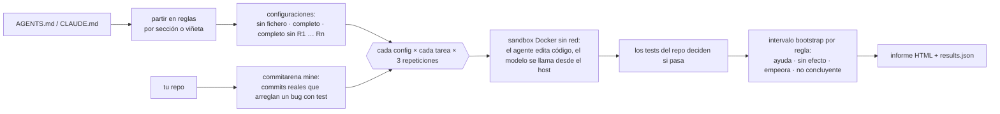

<p align="center">
  
</p>

<p align="center">
  <a href="https://github.com/diegoperezg7/rulelab/actions/workflows/ci.yml"></a>
  <a href="LICENSE"></a>
  <a href="https://github.com/diegoperezg7/rulelab/releases"></a>
  <a href="https://github.com/diegoperezg7/rulelab/stargazers"></a>
</p>

<p align="center"><b>Descubre qué líneas de tu AGENTS.md se ganan sus tokens.</b><br>
Quita una regla cada vez y mide acierto y coste en tareas reales.</p>

<p align="center"><a href="README.md">Read in English</a> · <a href="https://diegoperezg7.github.io/rulelab/">Informe de ejemplo</a></p>

<!-- DEMO_IMAGE -->

## Por qué

Cada línea de `AGENTS.md` o `CLAUDE.md` se envía al modelo en cada llamada. ¿Merece la pena?

La mejor evidencia hasta ahora dice que a menudo no. Gloaguen et al. (ETH Zúrich y LogicStar.ai,
[arXiv 2602.11988](https://arxiv.org/abs/2602.11988)) pusieron a Claude Code, Codex y Qwen Code
sobre SWE-bench Lite y CTXbench (138 tareas de 12 repositorios) y vieron que los ficheros de
contexto **no mejoran en general el acierto** y suben el coste de inferencia **más de un 20 % de
media**:

| Fichero de contexto | Acierto | Coste de inferencia |
| --- | --- | --- |
| Escrito por un LLM | −0,5 % (SWE-bench Lite), −2 % (CTXbench) | +20 %, +23 % |
| Escrito por desarrolladores | +2,4 % (no significativo) | hasta +19 % |

También vieron que las descripciones generales del repositorio no ayudan. Eso es la media de
muchos repos. A ti te importan tu fichero, tu repo y tu modelo, y el paper mide ficheros
enteros, no las reglas sueltas que de verdad borrarías.

rulelab hace ese experimento sobre **tu** repo, **regla a regla**.

| | Qué mide | Tareas |
| --- | --- | --- |
| [fernforge/ruleprof](https://github.com/fernforge/ruleprof) (0★) | Quita reglas de una en una y mira si el agente **obedece** cada regla | De juguete |
| [sx4im/skillcheck](https://github.com/sx4im/skillcheck) (29★) | A/B a ciegas del **fichero entero** frente a no tenerlo | Tus prompts |
| **rulelab** | Quita reglas de una en una y mide **acierto y coste** por regla | Arreglos reales del historial de tu repo, puntuados con sus propios tests |

Estrellas comprobadas con la API de GitHub el 3 nov 2026.

## Inicio rápido

Mira una ejecución real grabada (sin API key, sin Docker, en menos de un minuto):

```bash
uvx --from git+https://github.com/diegoperezg7/rulelab@v0.1.0 rulelab demo --open
```

o desde un clon:

```bash
git clone https://github.com/diegoperezg7/rulelab && cd rulelab && uv run rulelab demo --open
```

`uvx rulelab` llegará pronto a PyPI.

Después, sobre tu propio fichero y repo (necesita Docker, y Ollama o una API key):

```bash
rulelab split AGENTS.md                                   # cómo se parte el fichero, gratis
rulelab run AGENTS.md --repo . --dry-run                  # plan y coste estimado, gratis
rulelab run AGENTS.md --repo . --model ollama/qwen3:4b    # modelo local, 0 USD
rulelab run AGENTS.md --repo . --model mistral/codestral-latest --max-cost 5
```

## Salida de ejemplo

<!-- DEMO_OUTPUT -->

## Cómo funciona



1. **Partir.** `--granularity section` (por defecto) convierte cada encabezado en una regla;
   `bullet`, cada viñeta de primer nivel o párrafo. Un `# Título` suelto se mantiene en todas las
   configuraciones. Compruébalo con `rulelab split`.
2. **Configuraciones.** Sin fichero, fichero completo y fichero completo sin cada regla. Con
   *n* reglas son *n* + 2 configuraciones.
3. **Tareas.** Arreglos de bugs reales de tu historial de git, minados por
   [commitarena](https://github.com/diegoperezg7/commitarena): commits que añaden un test que falla
   antes del arreglo. El agente recibe los tests que fallan, nunca el mensaje del commit.
4. **Ejecuciones.** Cada configuración corre cada tarea `--repeats` veces (3 por defecto) en el
   mismo sandbox Docker sin red (2 CPU, 2 GB). El fichero se escribe en la raíz del repo y se añade
   al prompt de sistema (`--inject both|repo|prompt`). Antes se quita el AGENTS.md/CLAUDE.md propio
   del repo, así que «sin fichero» es sin fichero de verdad.
5. **Veredicto.** Efecto de una regla = acierto con el fichero completo − acierto sin ella. El
   intervalo del 95 % sale de un bootstrap en dos niveles (se remuestrean tareas y el acierto por
   tarea se saca de una posterior Beta(s+½, f+½), para que 3/3 frente a 3/3 no parezca una
   certeza). **Ayuda** si todo el intervalo está por encima de 0, **empeora** si está por debajo,
   **sin efecto** si cabe dentro de ±10 pp (`--margin`) y **no concluyente** en otro caso.
6. **Coste.** Tokens por regla (≈ caracteres / 4), la diferencia medida de tokens de entrada por
   ejecución y una proyección mensual: tokens de la regla × llamadas al modelo por ejecución ×
   sesiones al mes × precio de entrada.

### Leer el resultado con honestidad

Con 6 tareas y 3 repeticiones solo se distinguen del ruido los efectos grandes, así que **la
mayoría de reglas saldrán no concluyentes**. El informe lo dice tal cual en vez de forzar un
veredicto. «No concluyente» no es «inútil»: significa que este experimento no puede decidirlo.
Añade tareas (`--max-tasks`) o repeticiones antes de borrar una regla por eso.

## Configuración

| Opción | Por defecto | Qué hace |
| --- | --- | --- |
| `--repo` | | Repo git (ruta o URL) del que minar tareas |
| `--tasks-file` | | Reusar un `tasks.json` de `commitarena mine` |
| `--only` | todas | Ids de tarea separados por comas |
| `--max-tasks` | 6 | Tareas a minar con `--repo` |
| `--model`, `-m` | `ollama/qwen3:4b` | `ollama/…`, `mistral/…`, `openrouter/…`, `openai/…` |
| `--granularity`, `-g` | `section` | `section` o `bullet` |
| `--repeats`, `-n` | 3 | Ejecuciones por tarea y configuración |
| `--max-cost` | 1.0 | Tope de gasto en USD, comprobado antes de cada ejecución. Los modelos locales cuentan 0 |
| `--inject` | `both` | El fichero en la raíz del repo, en el prompt de sistema o en ambos |
| `--max-steps` | 30 | Llamadas al modelo por ejecución |
| `--price` | | `IN,OUT` en USD por 1M de tokens para modelos sin precio conocido |
| `--sessions-per-month` | 1000 | Para la proyección de coste mensual |
| `--out`, `-o` | `rulelab-results` | Escribe `results.json` (tras cada ejecución) y `report.html` |
| `--resume` | | Continuar una ejecución interrumpida o parada por presupuesto |
| `--dry-run` | | Solo imprime el plan y la estimación |

Antes de ejecutar nada, rulelab imprime el número de ejecuciones del agente y el coste estimado.
Si la estimación supera `--max-cost`, se para y te dice qué cantidad pasar. No se gasta nada
hasta que lo permites.

**Las claves** se leen solo de variables de entorno: `MISTRAL_API_KEY`, `OPENROUTER_API_KEY`,
`OPENAI_API_KEY` (ver [.env.example](.env.example)). Ollama no necesita ninguna (`OLLAMA_HOST`
para apuntar a otro sitio). rulelab no envía telemetría.

`rulelab report results.json` regenera el informe con otro `--margin`, `--price-in` o
`--sessions-per-month` sin volver a ejecutar nada.

## Hoja de ruta

Fuera de la v0.1:

- Tareas sintéticas para repos sin suficiente historial de arreglos.
- Comprobación de obediencia (¿siguió el agente la regla?) como segunda señal junto al acierto.
- `.cursor/rules` y skills.
- Interacciones entre reglas (quitar parejas o grupos).
- Reescritura automática de reglas que cuestan más de lo que ayudan.
- Publicación en PyPI (cuando commitarena esté en PyPI; PyPI no acepta la dependencia actual desde GitHub).

## Licencia

[MIT](LICENSE) © 2026 Diego Pérez. Las tareas de la demo salen de
[andialbrecht/sqlparse](https://github.com/andialbrecht/sqlparse) (BSD-3-Clause), minadas por
commitarena; el AGENTS.md de la demo en [`examples/demo`](examples/demo) se escribió para este
proyecto.
