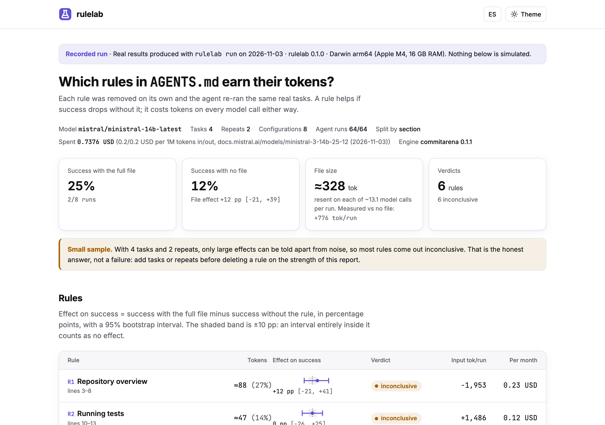
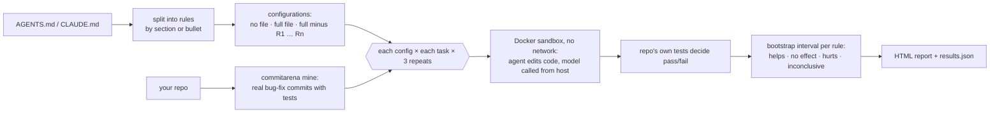

<p align="center">
  
</p>

<p align="center">
  <a href="https://github.com/diegoperezg7/rulelab/actions/workflows/ci.yml"></a>
  <a href="LICENSE"></a>
  <a href="https://github.com/diegoperezg7/rulelab/releases"></a>
  <a href="https://github.com/diegoperezg7/rulelab/stargazers"></a>
</p>

<p align="center"><b>Find out which lines of your AGENTS.md earn their tokens.</b><br>
Remove one rule at a time and measure success and cost on real tasks.</p>

<p align="center"><a href="README.es.md">Leer en español</a> · <a href="https://diegoperezg7.github.io/rulelab/">Example report</a></p>

<p align="center"></p>

<p align="center"><a href="https://diegoperezg7.github.io/rulelab/"></a></p>

## Why

Every line in `AGENTS.md` or `CLAUDE.md` is sent to the model on every call. Is it worth it?

The best evidence so far says "often not". Gloaguen et al. (ETH Zurich and LogicStar.ai,
[arXiv 2602.11988](https://arxiv.org/abs/2602.11988)) ran Claude Code, Codex and Qwen Code on
SWE-bench Lite and on CTXbench (138 tasks from 12 repositories) and found that context files
**do not generally improve task success rates** while raising inference cost **by over 20% on
average**:

| Context file | Success | Inference cost |
| --- | --- | --- |
| Written by an LLM | −0.5% (SWE-bench Lite), −2% (CTXbench) | +20%, +23% |
| Written by developers | +2.4% (not significant) | up to +19% |

They also found that repository overviews do not help. That is the average over many repos.
Your file, your repo and your model are what matter to you, and the paper measures whole files,
not the individual rules you would actually delete.

rulelab runs that experiment on **your** repo, **one rule at a time**.

| | What it measures | Tasks |
| --- | --- | --- |
| [fernforge/ruleprof](https://github.com/fernforge/ruleprof) (0★) | Removes rules one at a time; checks whether the agent **obeys** each rule | Toy tasks |
| [sx4im/skillcheck](https://github.com/sx4im/skillcheck) (29★) | Blind A/B test of the **whole file** against no file | Your prompts |
| **rulelab** | Removes rules one at a time; measures **task success and cost** per rule | Real bug fixes from your repo's history, scored by its own tests |

Star counts checked with the GitHub API on 3 Nov 2026.

## Quickstart

See a recorded real run (no API key, no Docker, under a minute):

```bash
uvx --from git+https://github.com/diegoperezg7/rulelab@v0.1.1 rulelab demo --open
```

or from a clone:

```bash
git clone https://github.com/diegoperezg7/rulelab && cd rulelab && uv run rulelab demo --open
```

`uvx rulelab` is coming to PyPI.

Then run it on your own file and repo (needs Docker, and Ollama or an API key):

```bash
rulelab split AGENTS.md                                   # see how the file is split, free
rulelab run AGENTS.md --repo . --dry-run                  # plan and cost estimate, free
rulelab run AGENTS.md --repo . --model ollama/qwen3:4b    # local model, 0 USD
rulelab run AGENTS.md --repo . --model mistral/ministral-14b-latest --price 0.2,0.2 -j 3
```

## Example output

```text
$ rulelab demo
Recorded run · real results from rulelab run on 2026-11-03 · rulelab 0.1.0 · Darwin arm64 (Apple M4, 16 GB RAM)
AGENTS.md · model mistral/ministral-14b-latest · 4 tasks × 2 repeats × 8 configs · 64 runs · 0.7376 USD
full file 2/8 · no file 1/8 · file effect +12 pp [−21, +39]
file tokens per run, estimated if resent on every call: ≈4,305 · measured difference vs no file: +776 [−15,405, +17,616]
 rule                    ≈tok   effect (pp, 95% CI)   verdict        USD/month
 R1 Repository overview    88        +12 [−21, +41]   inconclusive        0.23
 R2 Running tests          47          0 [−26, +25]   inconclusive        0.12
 R3 How to fix a bug       56        +12 [−20, +40]   inconclusive        0.15
 R4 Lexer and keywords     68          0 [−26, +27]   inconclusive        0.18
 R5 Code style             34          0 [−26, +27]   inconclusive        0.09
 R6 Communication          30          0 [−26, +26]   inconclusive        0.08
Small sample: most rules are inconclusive. [...]
```

**What this recorded run says, plainly.** The demo is a real `rulelab run` of a 6-rule
[AGENTS.md](examples/demo/AGENTS.md) (it includes a repository overview, as in the paper) on the 4
most recent tasks of commitarena's own demo set: bug fixes from
[sqlparse](https://github.com/andialbrecht/sqlparse), scored by sqlparse's tests
([tasks.json](examples/demo/tasks.json)). Model `mistral/ministral-14b-latest`, 15 agent steps,
2 repeats, commitarena 0.1.1: 64 agent runs, 27 minutes, 0.74 USD. The model was picked with a
4-run probe because it passed some tasks but not all (1 of 4), so the baseline is neither 0% nor
100% and an effect could show up.

13 of 64 runs passed. The full file passed 2/8 and no file 1/8 (+12 pp, interval −21 to +39).
Removing the repository overview or the bug-fixing rule dropped success from 2/8 to 1/8, but with
4 tasks and 2 repeats that is one run's difference: **every rule is inconclusive**, and the report
says so instead of forcing a verdict. What the run does pin down is the price: the file is ≈328
tokens; resent on each of ~13 model calls it would add an estimated ≈4,305 input tokens per run. The difference actually measured in this run (full file vs no file) was +776 input tokens per run, with a wide interval, because agent trajectories vary far more than that. To get a verdict,
run more tasks and repeats on your own repo.

An earlier, larger run (144 runs with codestral on an older commitarena build) solved 1 of 144
tasks and is not published as a result; it did prove that the run survives engine errors, budget
stops and interruptions (`--resume`).

The full report, with the annotated file, is published at
**[diegoperezg7.github.io/rulelab](https://diegoperezg7.github.io/rulelab/)** (EN/ES, light/dark).
Screenshots: [light](docs/assets/report-light.png) · [dark](docs/assets/report-dark.png) ·
[mobile](docs/assets/report-mobile.png).

## How it works



1. **Split.** `--granularity section` (default) makes each heading a rule; `bullet` makes each
   top-level bullet or paragraph a rule. A lone `# Title` line is kept in every configuration.
   Check the split with `rulelab split`.
2. **Configurations.** No file, the full file, and the full file without each rule
   (leave-one-out). With *n* rules that is *n* + 2 configurations.
3. **Tasks.** Real bug fixes from your git history, mined by
   [commitarena](https://github.com/diegoperezg7/commitarena): commits that add a test that fails
   before the fix. The agent gets the failing tests, never the commit message.
4. **Runs.** Every configuration runs every task `--repeats` times (default 3) in the same
   no-network Docker sandbox (2 CPU, 2 GB). The file is written at the repo root and appended to
   the system prompt (`--inject both|repo|prompt`). The repo's own AGENTS.md/CLAUDE.md is removed
   first, so "no file" really means none.
5. **Verdict.** Effect of a rule = success with the full file − success without it. The 95%
   interval comes from a two-level bootstrap (tasks resampled; each per-task rate drawn from a
   Beta(s+½, f+½) posterior, so 3/3 vs 3/3 does not look like certainty). **Helps** if the whole
   interval is above 0, **hurts** if below, **no effect** if it fits inside ±10 pp (`--margin`),
   **inconclusive** otherwise.
6. **Cost.** Tokens per rule (≈ characters / 4), the measured input-token difference per run, and
   a monthly projection: rule tokens × model calls per run × sessions per month × input price.

### Read the result honestly

With 6 tasks and 3 repeats, only large effects can be told apart from noise, so **most rules
will come out inconclusive**. The report says so in plain words instead of forcing a verdict.
"Inconclusive" is not "useless": it means this experiment cannot tell. Add tasks (`--max-tasks`)
or repeats before deleting a rule because of it.

## Configuration

| Option | Default | What it does |
| --- | --- | --- |
| `--repo` | | Git repo (path or URL) to mine tasks from |
| `--tasks-file` | | Reuse a `tasks.json` from `commitarena mine` |
| `--only` | all | Comma-separated task ids |
| `--max-tasks` | 6 | Tasks to mine with `--repo` |
| `--model`, `-m` | `ollama/qwen3:4b` | `ollama/…`, `mistral/…`, `openrouter/…`, `openai/…` |
| `--granularity`, `-g` | `section` | `section` or `bullet` |
| `--repeats`, `-n` | 3 | Runs per task and configuration |
| `--max-cost` | 1.0 | Hard budget in USD, checked before every run. Local models count as 0 |
| `--inject` | `both` | Put the file in the repo root, the system prompt, or both |
| `--max-steps` | 30 | Model calls per run |
| `--concurrency`, `-j` | 1 | Agent runs at the same time, each in its own sandbox |
| `--price` | | `IN,OUT` USD per 1M tokens for models without a known price |
| `--price-source` | | Where that price comes from; shown in the report |
| `--sessions-per-month` | 1000 | For the monthly cost projection |
| `--out`, `-o` | `rulelab-results` | Writes `results.json` (after every run) and `report.html` |
| `--resume` | | Continue an interrupted or budget-stopped run |
| `--dry-run` | | Print the plan and estimate only |

Before anything runs, rulelab prints the number of agent runs and the estimated cost. If the
estimate is over `--max-cost`, it stops and tells you the amount to pass instead. Nothing is spent
until you allow it.

**Small local models.** Ollama serves models with a 4,096-token context by default. An agent run
needs far more, and in our test `qwen3:4b` used up that window thinking and never ran a command.
Start Ollama with a bigger window (for example `OLLAMA_CONTEXT_LENGTH=32768 ollama serve`) before
using a local model.

**Keys** come only from environment variables: `MISTRAL_API_KEY`, `OPENROUTER_API_KEY`,
`OPENAI_API_KEY` (see [.env.example](.env.example)). Ollama needs none (`OLLAMA_HOST` to point
elsewhere). rulelab sends no telemetry.

`rulelab report results.json` rebuilds the report with another `--margin`, `--price-in` or
`--sessions-per-month` without re-running anything.

## Use it from Claude Code

Install the plugin and ask Claude in plain words; its `ablate-agent-rules` skill splits your file, shows the free cost estimate, runs the experiment only after you approve it and explains which rules help, hurt or cannot be told apart yet.

```text
/plugin install rulelab --marketplace diegoperezg7/rulelab
```

The skill tells Claude to ask before any paid run, and `--max-cost` still caps the spend.

## Roadmap

Not in v0.1:

- Synthetic tasks for repos without enough bug-fix history.
- Adherence checks (did the agent follow the rule?), as a second signal next to success.
- `.cursor/rules` and skills.
- Rule interactions (removing pairs or groups).
- Automatic rewrites of rules that cost more than they help.
- PyPI release (after commitarena is on PyPI; PyPI does not accept the current GitHub dependency).

## Part of a series

Open source tools that evaluate agents and LLMs on your own data:

- [memarena](https://github.com/diegoperezg7/memarena): Benchmark memory layers on your own conversations.
- [parsearena](https://github.com/diegoperezg7/parsearena): Compare PDF parsers side by side and their effect on retrieval.
- [commitarena](https://github.com/diegoperezg7/commitarena): Replay real bug fixes from your git history against any model.
- [toolbloat](https://github.com/diegoperezg7/toolbloat): Measure the token cost of your MCP stack and tool-choice errors.
- [doesitfire](https://github.com/diegoperezg7/doesitfire): Test whether your SKILL.md activates in Claude Code, Codex and OpenCode.

## License

[MIT](LICENSE) © 2026 Diego Pérez. The demo tasks contain code and tests from
[andialbrecht/sqlparse](https://github.com/andialbrecht/sqlparse) (BSD-3-Clause, see
[THIRD_PARTY_NOTICES.md](THIRD_PARTY_NOTICES.md)), taken from commitarena's demo set; the demo
AGENTS.md in [`examples/demo`](examples/demo) was written for this project.
