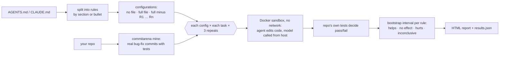

<p align="center">
  
</p>

<p align="center">
  <a href="https://github.com/diegoperezg7/rulelab/actions/workflows/ci.yml"></a>
  <a href="LICENSE"></a>
  <a href="https://github.com/diegoperezg7/rulelab/releases"></a>
  <a href="https://github.com/diegoperezg7/rulelab/stargazers"></a>
</p>

<p align="center"><b>Find out which lines of your AGENTS.md earn their tokens.</b><br>
Remove one rule at a time and measure success and cost on real tasks.</p>

<p align="center"><a href="README.es.md">Leer en español</a> · <a href="https://diegoperezg7.github.io/rulelab/">Example report</a></p>

<!-- DEMO_IMAGE -->

## Why

Every line in `AGENTS.md` or `CLAUDE.md` is sent to the model on every call. Is it worth it?

The best evidence so far says "often not". Gloaguen et al. (ETH Zurich and LogicStar.ai,
[arXiv 2602.11988](https://arxiv.org/abs/2602.11988)) ran Claude Code, Codex and Qwen Code on
SWE-bench Lite and on CTXbench (138 tasks from 12 repositories) and found that context files
**do not generally improve task success rates** while raising inference cost **by over 20% on
average**:

| Context file | Success | Inference cost |
| --- | --- | --- |
| Written by an LLM | −0.5% (SWE-bench Lite), −2% (CTXbench) | +20%, +23% |
| Written by developers | +2.4% (not significant) | up to +19% |

They also found that repository overviews do not help. That is the average over many repos.
Your file, your repo and your model are what matter to you, and the paper measures whole files,
not the individual rules you would actually delete.

rulelab runs that experiment on **your** repo, **one rule at a time**.

| | What it measures | Tasks |
| --- | --- | --- |
| [fernforge/ruleprof](https://github.com/fernforge/ruleprof) (0★) | Removes rules one at a time; checks whether the agent **obeys** each rule | Toy tasks |
| [sx4im/skillcheck](https://github.com/sx4im/skillcheck) (29★) | Blind A/B test of the **whole file** against no file | Your prompts |
| **rulelab** | Removes rules one at a time; measures **task success and cost** per rule | Real bug fixes from your repo's history, scored by its own tests |

Star counts checked with the GitHub API on 3 Nov 2026.

## Quickstart

See a recorded real run (no API key, no Docker, under a minute):

```bash
uvx --from git+https://github.com/diegoperezg7/rulelab@v0.1.0 rulelab demo --open
```

or from a clone:

```bash
git clone https://github.com/diegoperezg7/rulelab && cd rulelab && uv run rulelab demo --open
```

`uvx rulelab` is coming to PyPI.

Then run it on your own file and repo (needs Docker, and Ollama or an API key):

```bash
rulelab split AGENTS.md                                   # see how the file is split, free
rulelab run AGENTS.md --repo . --dry-run                  # plan and cost estimate, free
rulelab run AGENTS.md --repo . --model ollama/qwen3:4b    # local model, 0 USD
rulelab run AGENTS.md --repo . --model mistral/codestral-latest --max-cost 5
```

## Example output

<!-- DEMO_OUTPUT -->

## How it works



1. **Split.** `--granularity section` (default) makes each heading a rule; `bullet` makes each
   top-level bullet or paragraph a rule. A lone `# Title` line is kept in every configuration.
   Check the split with `rulelab split`.
2. **Configurations.** No file, the full file, and the full file without each rule
   (leave-one-out). With *n* rules that is *n* + 2 configurations.
3. **Tasks.** Real bug fixes from your git history, mined by
   [commitarena](https://github.com/diegoperezg7/commitarena): commits that add a test that fails
   before the fix. The agent gets the failing tests, never the commit message.
4. **Runs.** Every configuration runs every task `--repeats` times (default 3) in the same
   no-network Docker sandbox (2 CPU, 2 GB). The file is written at the repo root and appended to
   the system prompt (`--inject both|repo|prompt`). The repo's own AGENTS.md/CLAUDE.md is removed
   first, so "no file" really means none.
5. **Verdict.** Effect of a rule = success with the full file − success without it. The 95%
   interval comes from a two-level bootstrap (tasks resampled; each per-task rate drawn from a
   Beta(s+½, f+½) posterior, so 3/3 vs 3/3 does not look like certainty). **Helps** if the whole
   interval is above 0, **hurts** if below, **no effect** if it fits inside ±10 pp (`--margin`),
   **inconclusive** otherwise.
6. **Cost.** Tokens per rule (≈ characters / 4), the measured input-token difference per run, and
   a monthly projection: rule tokens × model calls per run × sessions per month × input price.

### Read the result honestly

With 6 tasks and 3 repeats, only large effects can be told apart from noise, so **most rules
will come out inconclusive**. The report says so in plain words instead of forcing a verdict.
"Inconclusive" is not "useless": it means this experiment cannot tell. Add tasks (`--max-tasks`)
or repeats before deleting a rule because of it.

## Configuration

| Option | Default | What it does |
| --- | --- | --- |
| `--repo` | | Git repo (path or URL) to mine tasks from |
| `--tasks-file` | | Reuse a `tasks.json` from `commitarena mine` |
| `--only` | all | Comma-separated task ids |
| `--max-tasks` | 6 | Tasks to mine with `--repo` |
| `--model`, `-m` | `ollama/qwen3:4b` | `ollama/…`, `mistral/…`, `openrouter/…`, `openai/…` |
| `--granularity`, `-g` | `section` | `section` or `bullet` |
| `--repeats`, `-n` | 3 | Runs per task and configuration |
| `--max-cost` | 1.0 | Hard budget in USD, checked before every run. Local models count as 0 |
| `--inject` | `both` | Put the file in the repo root, the system prompt, or both |
| `--max-steps` | 30 | Model calls per run |
| `--price` | | `IN,OUT` USD per 1M tokens for models without a known price |
| `--sessions-per-month` | 1000 | For the monthly cost projection |
| `--out`, `-o` | `rulelab-results` | Writes `results.json` (after every run) and `report.html` |
| `--resume` | | Continue an interrupted or budget-stopped run |
| `--dry-run` | | Print the plan and estimate only |

Before anything runs, rulelab prints the number of agent runs and the estimated cost. If the
estimate is over `--max-cost`, it stops and tells you the amount to pass instead. Nothing is spent
until you allow it.

**Keys** come only from environment variables: `MISTRAL_API_KEY`, `OPENROUTER_API_KEY`,
`OPENAI_API_KEY` (see [.env.example](.env.example)). Ollama needs none (`OLLAMA_HOST` to point
elsewhere). rulelab sends no telemetry.

`rulelab report results.json` rebuilds the report with another `--margin`, `--price-in` or
`--sessions-per-month` without re-running anything.

## Roadmap

Not in v0.1:

- Synthetic tasks for repos without enough bug-fix history.
- Adherence checks (did the agent follow the rule?), as a second signal next to success.
- `.cursor/rules` and skills.
- Rule interactions (removing pairs or groups).
- Automatic rewrites of rules that cost more than they help.
- PyPI release (after commitarena is on PyPI; PyPI does not accept the current GitHub dependency).

## License

[MIT](LICENSE) © 2026 Diego Pérez. The demo tasks come from
[andialbrecht/sqlparse](https://github.com/andialbrecht/sqlparse) (BSD-3-Clause), mined by
commitarena; the demo AGENTS.md in [`examples/demo`](examples/demo) was written for this project.
